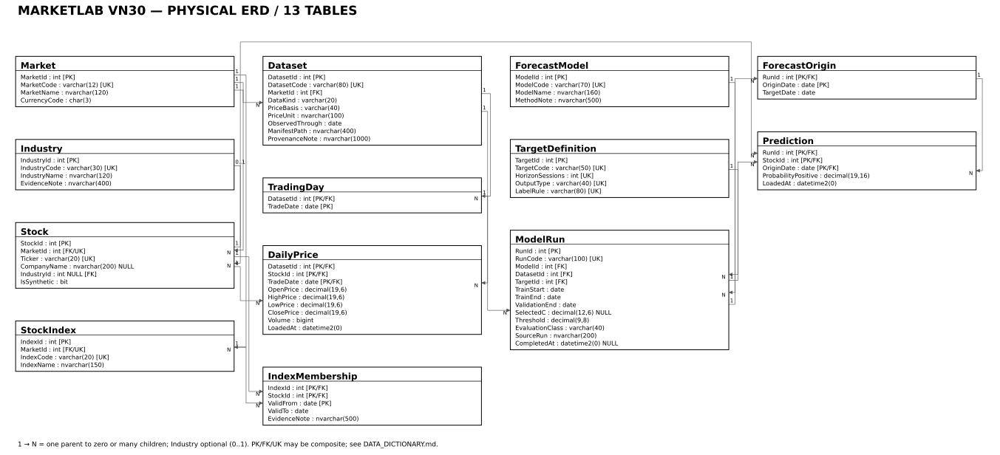

# MarketLab VN30 — Bài tập lớn Hệ quản trị cơ sở dữ liệu

Hệ thống SQL Server quản lý dữ liệu thị trường và **các dự báo đã có**, minh họa thiết kế quan hệ 3NF, toàn vẹn dữ liệu, truy vấn và transaction. Dự án không huấn luyện AI và không cần website.

**Bắt đầu:** [cài đặt](docs/INSTALLATION_GUIDE.md) → [demo SSMS](docs/DEMO_GUIDE.md). Thành viên nhóm đọc [bàn giao](docs/TEAM_HANDOFF.md), [hướng dẫn báo cáo](docs/REPORT_WRITING_GUIDE.md) và [hướng dẫn slide](docs/SLIDE_BUILD_GUIDE.md).

## 1. Giới thiệu

MarketLab VN30 nối dữ liệu giá theo phiên với dự báo xác suất tăng giá, theo đúng dataset, mã, ngày gốc, ngày mục tiêu và lần chạy. Bản công khai là bộ bài tập độc lập dùng **dữ liệu mô phỏng**; chỉ có thống kê tổng hợp của nghiên cứu trong tài liệu tham khảo.

## 2. Bài toán

Giá và dự báo rời rạc dễ bị trùng khóa, ghép nhầm thời điểm hoặc chấm dự báo khi chưa có giá mục tiêu. CSDL cần giữ nguồn/đơn vị, lịch phiên, cấu hình run và quy tắc đánh giá rõ ràng; dữ liệu thiếu phải còn nhìn thấy.

## 3. Mục tiêu

- Thiết kế 13 bảng, PK/FK/UNIQUE/CHECK/DEFAULT và các trigger liên bảng.
- Thực hiện 16 truy vấn, 4 stored procedures, 3 functions và 4 views.
- Chỉ đánh giá dự báo đủ giá đầu/cuối và đã trưởng thành; so sánh các run trên cùng quan sát.
- Minh họa từ chối dữ liệu sai và ROLLBACK bằng SQL chạy được.

## 4. Phạm vi

Quản lý danh mục, OHLCV, lịch phiên, thành phần chỉ số có hiệu lực, mô hình, lần chạy và dự báo xác suất. Không cung cấp khuyến nghị đầu tư, lịch sử thành phần VN30 đầy đủ, benchmark xác nhận hay hệ thống huấn luyện mô hình. [Yêu cầu nghiệp vụ](docs/REQUIREMENTS.md).

## 5. Công nghệ

T-SQL, SQL Server, SSMS hoặc `sqlcmd`; Git/GitHub để phối hợp. Đã chạy trên **SQL Server 2025 Standard Developer, 17.0.1145.4**. Mục tiêu tương thích 2016 SP1+ trong chú thích SQL chưa phải chứng nhận runtime Express/2016. SQL demo không cần Python. Python 3.10+ dùng cho kiểm chứng tùy chọn; PyMuPDF/Pillow dùng cho QA tài liệu.

## 6. Kiến trúc và thư mục

```text
README.md / CONTRIBUTING.md
docs/                 Thiết kế, hướng dẫn nhóm, kiểm toán công bố
  diagrams/           ERD Mermaid, SVG, PNG, PDF
sql/                  SQL đã kiểm chứng, gồm all_in_one.sql
data/sample/          CSV + JSON hoàn toàn mô phỏng
data/manifests/       Chỉ manifest dữ liệu mô phỏng
scripts/              Chạy demo, tái tạo SQL mẫu và kiểm chứng công khai
tests/                Unit tests, fixture DDL cũ, bằng chứng đã rà soát
report/               Báo cáo tham khảo MD, DOCX, PDF
slides/               Slide tham khảo MD, PPTX, PDF
```

Luồng dữ liệu: danh mục + Dataset/TradingDay → DailyPrice; ForecastModel + TargetDefinition + Dataset → ModelRun → ForecastOrigin/Prediction → hàm đủ điều kiện → view/procedure đánh giá. [Tổng quan](docs/PROJECT_OVERVIEW.md).

## 7. Bảng và quan hệ

|Bảng|Vai trò / khóa chính|
|---|---|
|Market|Thị trường; MarketId|
|Industry|Ngành có bằng chứng hoặc nhãn mô phỏng; IndustryId|
|Stock|Mã trong thị trường; StockId; UNIQUE(MarketId,Ticker)|
|Dataset|Phạm vi nguồn, loại dữ liệu, đơn vị, ngày đã quan sát; DatasetId|
|TradingDay|Lịch riêng từng dataset; (DatasetId,TradeDate)|
|DailyPrice|OHLCV; **(DatasetId,StockId,TradeDate)**|
|StockIndex|Chỉ số theo thị trường; IndexId|
|IndexMembership|Giải N–N chỉ số–mã; (IndexId,StockId,ValidFrom)|
|ForecastModel|Phương pháp dự báo; ModelId|
|TargetDefinition|Định nghĩa đầu ra và horizon; TargetId|
|ModelRun|Cấu hình một lần chạy; RunId|
|ForecastOrigin|Ngày mục tiêu theo (RunId,OriginDate)|
|Prediction|Xác suất theo (RunId,StockId,OriginDate)|

Schema hiện hành có 73 cột, 16 FK với 18 cặp cột. IndustryId của Stock có thể NULL; FK khác bắt buộc. Không cascade xóa. [Thiết kế](docs/DATABASE_DESIGN.md), [từ điển từng cột](docs/DATA_DICTIONARY.md).

## 8. ERD



[PDF để phóng to](docs/diagrams/marketlab_erd.pdf) · [PNG](docs/diagrams/marketlab_erd.png) · [nguồn Mermaid](docs/diagrams/marketlab_erd.mmd). Sơ đồ đầy đủ khá dày; khi trình bày nên phóng to từng nhóm.

## 9. Chuẩn hóa

Prediction có khóa (RunId,StockId,OriginDate), nhưng `(RunId,OriginDate) → TargetDate`. Tách ForecastOrigin loại phụ thuộc bộ phận, JOIN lại bằng FK ghép không nhân bản ghi. Không lưu lặp tên mô hình, ngành, đơn vị giá hoặc ActualLabel trong Prediction. [Phân tích 1NF/2NF/3NF và migration](docs/NORMALIZATION.md).

## 10. Dữ liệu

|Phạm vi|Nội dung|Có trong GitHub?|
|---|---|---|
|SYNTHETIC DEMONSTRATION DATA|8 mã DEMO, 2 ngành giả định, 42 ngày lịch, 280 giá, 258 dự báo, 34 ForecastOrigin; horizon 5|Có, chỉ để học và demo|
|Đủ điều kiện mô phỏng|256 dự báo, 128/run; 2 thiếu endpoint|Có; không phải kết quả thị trường|
|REAL RESEARCH DATA|30 mã, 1.200 giá, 1.200 dự báo; tập con retrospective, horizon 20|Không có bản ghi hoặc manifest nguồn; chỉ thống kê trong báo cáo|

Lịch demo bỏ cuối tuần, không khẳng định là lịch HOSE. Quyền phân phối dữ liệu nghiên cứu còn UNKNOWN nên dữ liệu đó được giữ riêng. [Kiểm kê công khai](docs/DATA_INVENTORY.md), [manifest demo](data/manifests/demo_manifest.json).

## 11. Cài đặt

```powershell
git clone https://github.com/nicholas-atptit/bai-tap-lon-csdl-2026.git
cd bai-tap-lon-csdl-2026
```

Mở SSMS, kết nối instance của bạn bằng tài khoản có quyền tạo database. Máy tác giả dùng `.` và Windows Authentication; máy khác có thể có tên instance khác. Mở [sql/all_in_one.sql](sql/all_in_one.sql), chạy toàn bộ bằng F5; không cần SQLCMD mode, đường dẫn ổ K hay nguồn riêng. Không chạy trên database nghiên cứu. [Chi tiết cài đặt và xử lý lỗi](docs/INSTALLATION_GUIDE.md).

## 12. Thứ tự SQL

Dùng **một** cách: `all_in_one.sql` đã ghép 00–06; hoặc lần lượt 00 tạo DB → 01 bảng → 02 ràng buộc/index/trigger → 03 dữ liệu mô phỏng → 04 functions → 05 views → 06 procedures. Sau đó: **10 preflight → 09 demo → 07 queries → 08 validation**. File 12 là truy vấn tổng hợp tùy chọn trên DB nghiên cứu riêng, không thuộc đường chạy công khai.

Script tạo database nếu chưa có, không DROP/reset; có bảo vệ database không thuộc MarketLab. Không sửa script để vượt qua kiểm tra bảo vệ.

## 13. Truy vấn nghiệp vụ

[07_business_queries.sql](sql/07_business_queries.sql) có Q01–Q16: SELECT; INNER/LEFT/FULL JOIN; GROUP BY; HAVING; subquery; UNION; INTERSECT; EXCEPT; LIKE; BETWEEN; TOP; functions và views. [Giải thích từng truy vấn](docs/BUSINESS_QUERIES.md). Kết quả 0 dòng của truy vấn phát hiện thiếu dữ liệu có thể hợp lệ; phải phân biệt với không có output.

## 14. Procedures, functions, views

|Nhóm|Đối tượng|
|---|---|
|4 procedures|usp_InsertDailyPrice, usp_AddPrediction, usp_GetModelPerformance, usp_CompareModels|
|3 functions|fn_CalculateReturn, fn_CheckPredictionDirection, fn_EligiblePredictions|
|4 views|vw_LatestStockPrice, vw_StudyUniverse, vw_VN30SnapshotJune2026, vw_ModelPerformance|

Mã nguồn tại [06](sql/06_stored_procedures.sql), [04](sql/04_functions.sql), [05](sql/05_views.sql). CompareModels chỉ dùng giao (StockId,OriginDate,TargetDate), cùng dataset/mục tiêu. Nhãn thực bằng 1 khi Close mục tiêu > Close gốc; bằng 0 khi giảm hoặc hòa. Cần TargetDate ≤ AsOfDate và ObservedThrough cùng đủ hai giá. Accuracy/Brier/log loss là mô tả; không tự suy ra ưu thế thống kê.

## 15. Kiểm thử

[44 ca SQL](sql/08_validation_tests.sql) gồm ca hợp lệ và 30 ca từ chối có chủ đích, dùng transaction/ROLLBACK. Trình kiểm chứng công khai không triển khai lại DB: preflight chỉ đọc trước, chụp hash tất cả hàng/cột của 13 bảng, chạy 44 ca/16 query/demo, tính lại chỉ tiêu bằng Python rồi so hash sau. Chỉ chấp nhận database mô phỏng đã triển khai.

```powershell
python -X utf8 -m unittest discover -s tests -p "test_*.py" -v
python -X utf8 scripts/check_publication.py
python -X utf8 scripts/run_public_regression.py --server .
```

Các lệnh trên cần Python, riêng regression cần `sqlcmd` và DB demo có sẵn. [Hướng dẫn kiểm chứng](tests/README.md). Kết quả cũ trong `tests/reference_evidence` được ghi rõ là lịch sử; không dùng receipt cũ để tuyên bố máy người đọc đã PASS.

## 16. Demo trực tiếp

Chạy [10_preflight_live.sql](sql/10_preflight_live.sql) rồi toàn bộ [09_live_demo.sql](sql/09_live_demo.sql). Năm phần khoảng 4 phút: PK/FK → JOIN/GROUP/HAVING/subquery → procedure/functions → CHECK từ chối Volume âm → BEFORE/DURING/AFTER ROLLBACK, hash bằng nhau và @@TRANCOUNT=0. Phần 4–5 chia sẻ biến nên chạy cùng nhau. [Kịch bản](docs/DEMO_GUIDE.md), [30 câu phản biện](docs/DEFENSE_QA.md).

## 17. Kết quả đã kiểm chứng

Đợt bàn giao trước công bố: 44 ca × 4 database = **176 lượt PASS**, 16 query × 4 = **64 lượt**; 7 unit regression cho verifier, 4 ca kiểm tra receipt; 3 preflight/5 demo trong regression và launcher thêm một vòng. Migration DDL 12 bảng gốc giữ 258 Prediction cùng LoadedAt, tạo 34 ForecastOrigin; fixture mâu thuẫn bị từ chối trước đổi schema. Đây là 44 ca khác nhau được lặp trong 4 môi trường DB, không phải 176 ca độc lập.

Bằng chứng: [tóm tắt lịch sử](tests/reference_evidence/final_regression_summary.json), [log 44 ca](tests/reference_evidence/44_tests_existing_demo.log), [migration](tests/reference_evidence/migration_lossless.log). Kết quả kiểm chứng và commit thực sự công bố được ghi ở [PUBLICATION_AUDIT](docs/PUBLICATION_AUDIT.md); không đồng nhất lịch sử kiểm thử với lần công bố mới.

## 18. Giới hạn

- Express/2016 runtime **NOT VERIFIED**; compatibility 130 không thay thế kiểm tra engine khác.
- Tên công ty/ngành/timestamp hoàn tất nguồn chưa có bằng chứng: giữ NULL. Adjustment/đơn vị quy đổi UNKNOWN; Close không phải total return.
- VN30 chỉ có snapshot 06/2026; không suy diễn lịch sử 2025 hay thành phần hiện tại.
- Quyền phân phối bản ghi nghiên cứu **BLOCKED**; GitHub tái hiện demo mô phỏng, không tái hiện toàn bộ nghiên cứu riêng.
- Word Save/native PDF còn BLOCKED; PDF báo cáo từ cùng Markdown qua Edge, không tuyên bố bố cục từng trang giống Word. PDF slide xuất bằng PowerPoint. SSMS GUI tự động chưa được xác minh; SQL đã chạy qua sqlcmd.
- Chưa benchmark tải lớn. [Kiểm toán 39 vấn đề và 9 blocker](docs/HISTORICAL_FAILURE_AUDIT.md).

## 19. Báo cáo và bài trình chiếu

- Báo cáo đã duyệt: [DOCX](report/MarketLabVN30_Report.docx), [PDF 9 trang](report/MarketLabVN30_Report.pdf), [Markdown](report/MarketLabVN30_Report.md).
- Slide đã duyệt: [PPTX](slides/MarketLabVN30_Presentation.pptx), [PDF 14 slide](slides/MarketLabVN30_Presentation.pdf), [Markdown có notes](slides/MarketLabVN30_Presentation.md).
- [Hướng dẫn người viết báo cáo: 22 mục và ánh xạ bằng chứng](docs/REPORT_WRITING_GUIDE.md).
- [Hướng dẫn người làm slide: 14 slide, thời gian và lời dẫn](docs/SLIDE_BUILD_GUIDE.md).

Các file đã duyệt là tài liệu tham khảo khóa theo hash. Tạo bản làm việc riêng và PR để được review trước khi thay thế. Ảnh render PDF là bản xem tài liệu, không phải screenshot SSMS.

