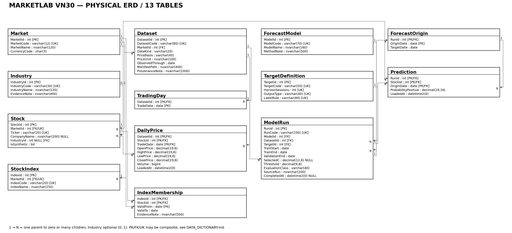

<!-- maintained-live-slides -->

# Bài toán và mục tiêu

- Quản lý giá, lịch phiên và dự báo đã có trong CSDL quan hệ.
- Đánh giá khi đã có dữ liệu thực tế ở ngày mục tiêu.
- Trọng tâm: 3NF, khóa, SQL và transaction.
- Demo độc lập bằng dữ liệu mô phỏng có nhãn.

::: notes
Khoảng 45 giây. Nêu rõ không huấn luyện mô hình mới và không dùng dữ liệu mô phỏng làm kết quả nghiên cứu.
:::

# Phạm vi và dữ liệu

- Nguồn: KBS/Vnstock; dự báo Stage 1 cùng lineage.
- Tập con: 30 mã, 40 phiên, 1.200 giá, 1.200 dự báo.
- 20 ngày gốc 03–30/09/2025; mục tiêu sau 20 phiên.
- 35/35 tệp nguồn không đổi; 30/30 giá khớp manifest.

::: notes
Khoảng 60 giây. Đây là đánh giá retrospective và vũ trụ khóa 06/2026; không khẳng định thành phần lịch sử 2025.
:::

# Chức năng hệ thống

- Danh mục thị trường, ngành, mã và chỉ số.
- Lịch phiên và OHLCV theo dataset.
- Mô hình, lần chạy, ngày gốc và dự báo xác suất.
- Tra cứu, thống kê và so sánh trên cùng quan sát.

# ERD: 13 bảng liên kết

::: notes
Khoảng 75 giây. Chỉ ra ba nhóm: danh mục; giá/lịch; mô hình/dự báo. Industry là quan hệ tùy chọn; IndexMembership giải N–N.
:::

# Vì sao tách ForecastOrigin?

- Prediction có khóa: run + mã + ngày gốc.
- Ngày mục tiêu chỉ phụ thuộc run + ngày gốc.
- ForecastOrigin lưu ánh xạ này một lần.
- JOIN qua PK/FK khôi phục đúng ngày, không nhân dự báo.

::: notes
Khoảng 60 giây. Đây là phụ thuộc bộ phận thật đã loại bỏ; không lưu lặp ModelName, PriceUnit hay ActualLabel trong Prediction.
:::

# Kiểu dữ liệu và toàn vẹn

- DECIMAL cho giá/xác suất; BIGINT cho khối lượng.
- PK, FK, UNIQUE, NOT NULL, DEFAULT, CHECK.
- Giá dương, High/Low hợp lý, Volume ≥ 0.
- Trigger kiểm tra horizon, ngoài mẫu và khoảng hiệu lực.

# Nhập dữ liệu có thể chạy lại

- Kiểm tra hash, ngày, khóa, OHLCV và endpoint.
- Batch 200 hàng, transaction và receipt.
- Cùng khóa/cùng giá trị: bỏ qua.
- Cùng khóa/khác giá trị: lỗi và rollback toàn batch.

# Truy vấn tiêu biểu

- JOIN danh mục và giá; GROUP BY ngành, HAVING độ phủ.
- FULL JOIN đối chiếu phạm vi giá/dự báo.
- EXCEPT phát hiện mã có giá nhưng chưa có dự báo.
- TOP thay đổi Close nguồn; BETWEEN khoảng ngày.
- 16 truy vấn đã chạy trên cả hai database chính.

# Thủ tục, hàm và view

- 4 procedures: ghi giá, thêm dự báo, đánh giá, so sánh.
- Hàm lợi suất, so chiều và tập dự báo đủ điều kiện.
- 4 views: giá cuối, phạm vi, snapshot, hiệu quả.
- AsOfDate + hai endpoint ngăn chấm nhãn chưa trưởng thành.

# So sánh công bằng trên tập con

|Chỉ tiêu|Baseline|Logistic L2|
|---|---:|---:|
|Quan sát chung|600|600|
|Accuracy|0,580000|0,568333|
|Brier|0,247666|0,252362|
|Log loss|0,688478|0,698052|

::: notes
SQL được đối chiếu độc lập bằng Python. Chỉ mô tả tập con; không kết luận ưu thế thống kê hoặc hiệu quả đầu tư.
:::

# Kiểm thử thực tế

- 44 ca SQL trên 4 database: 176 lượt PASS.
- Database mới và migration 12→13 đã được thử lại.
- Kiểm tra ràng buộc, lỗi thủ tục, common support, rollback.
- STATISTICS IO/TIME có log thực; chưa đo tải lớn.
- Engine đã chạy: SQL Server 2025 Developer, chưa có Express riêng.

# Demo trực tiếp: khoảng 4 phút

1. Chạy 10_preflight_live.sql, rồi 09_live_demo.sql.
2. JOIN/GROUP BY và view giá gần nhất.
3. CHECK từ chối volume âm; rollback.
4. Gọi CompareModels: 128 quan sát chung/run mô phỏng.
5. Xem Volume trước–trong–sau ROLLBACK; hash không đổi.

::: notes
Dùng docs/DEMO_GUIDE.md. Nếu máy trình bày không có nguồn thật, bản demo vẫn độc lập. Không trình bày chỉ tiêu mô phỏng như kết quả nghiên cứu.
:::

# Kết quả và giới hạn

- Đủ CSDL, SQL độc lập, pipeline và tài liệu tiếng Việt.
- 3NF và quy tắc thời gian có bằng chứng kiểm thử.
- Ngành/tên công ty chưa có → NULL; adjustment UNKNOWN.
- VN30 chỉ là snapshot 06/2026; không có lịch sử đầy đủ.
- Dữ liệu thật giữ nội bộ; gói demo chỉ dùng mô phỏng.

::: notes
Khoảng 45 giây, rồi trả lời câu hỏi. Hướng mở rộng: metadata có nguồn, lịch sử thành phần và kiểm thử Express.
:::
